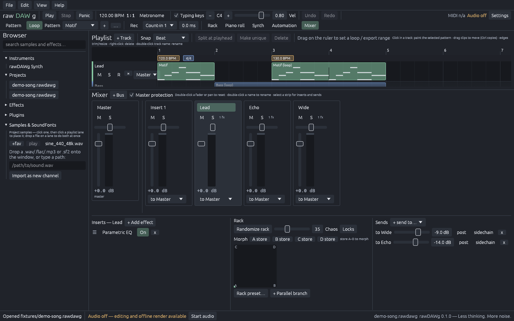

# rawDAWg

[](https://github.com/leo-aa88/rawDAWg/actions/workflows/ci.yml)
[](https://github.com/leo-aa88/rawDAWg/actions/workflows/release.yml)
[](https://github.com/leo-aa88/rawDAWg/releases)
[](LICENSE)
[](rust-toolchain.toml)
[](#install)
[](#plugins)
[](PROGRESS.md)

**Less thinking. More noise.**

rawDAWg is a native experimental digital audio workstation for Windows and Ubuntu. It is built
for playing with sound rather than reasoning about how to make it: a playable synth on start-up,
one-click variations, a waveform you sculpt while the note rings, and every change undoable.
Written in Rust with its own DSP, synth and engine (egui/wgpu interface, dark only); no Electron,
no web view, no JUCE.



## What it does

- **Synth**: wavetable with motion frames, subtractive, 4-operator FM/PM, additive, granular and
  plucked-string generators in up to four layers; draw and deform the waveform while it plays; a
  typed modular graph (per voice and global) for the adventurous.
- **Instant ideas**: 29 original presets, **Randomize** with chaos and locks, **Evolve** (nine
  variations of the current sound to audition and pick from), and a four-corner morph pad.
- **Sampler and SoundFont** instruments, audio clips (WAV, FLAC, MP3) streamed from disk.
- **Sequencing**: channel rack with steps, piano roll, playlist with patterns and audio clips,
  automation and LFO clips, count-in recording from the typing keyboard or MIDI.
- **Mixer**: buses, sends (pre/post, sidechain), latency compensation, master protection, and
  16 effect families from parametric EQ and dynamics to granular, spectral and convolution reverb.
- **Files**: folder projects with autosave and crash recovery, `.rawdawgpreset` presets, WAV/FLAC
  and stem export, MIDI import and export.
- **Plugins**: hosts third-party CLAP and VST3 plugins (isolated scanning, quarantine, safe mode,
  their own editor windows), and ships its synth and effects as CLAP and VST3 plugins for other
  hosts.

## Status

Pre-release. Milestones M0–M7 of the [roadmap](docs/ROADMAP.md) are implemented with their
automated gates passing, and M8 (packaging, robustness, performance, releases) is in progress. CI
builds, tests and packages every commit on Ubuntu 24.04 and Windows. Gates that need real audio
hardware, a manual GUI pass on both systems, plugin validators and independent hosts are still
open; [`PROGRESS.md`](PROGRESS.md) lists exactly what has and has not been verified, and
[`docs/verification/requirements.md`](docs/verification/requirements.md) links every requirement
to its evidence.

## Install

Download the package for your system from the
[latest release](https://github.com/leo-aa88/rawDAWg/releases):

| System | Package |
|---|---|
| Ubuntu 24.04 (x86-64) | `rawdawg-<version>-x86_64.deb`: `sudo apt install ./rawdawg-<version>-x86_64.deb` |
| Windows 11 (x64) | `rawdawg-<version>-x86_64.msi` installer, or the portable `rawdawg-<version>-x86_64.zip` |

Each package contains `rawdawg`, its CLAP and VST3 plugins (installed into the system plugin
folders), the user guide, license notices and a CycloneDX SBOM. Packages are **unsigned** until
signing is set up; check downloads against `SHA256SUMS.txt`. No AppImage, Snap or Flatpak.

## Quick start

1. Start `rawdawg`. A **rawDAWg Synth** channel is ready: play it with the typing keyboard
   (`Z X C V B N M` and `S D G H J`).
2. Click a preset, or press **New generation from current** for nine variations.
3. Hold a note and drag on the waveform to reshape it.
4. Arm **Rec**, press Space and play; your notes land in the piano roll.

The [user guide](docs/USER_GUIDE.md) covers the keyboard map, the command line, plugins,
installing and troubleshooting.

## Build from source

The toolchain is pinned in `rust-toolchain.toml` (Rust 1.99). On Ubuntu install
`build-essential pkg-config libasound2-dev libxkbcommon-dev libwayland-dev libudev-dev`
(plus `libjack-jackd2-dev` for `--features jack`); on Windows the MSVC Build Tools.

```bash
cargo run --release -p rawdawg                  # build and start
cargo test --workspace --locked                 # tests
cargo xtask verify --suite headless             # headless verification suite
cargo xtask package --format deb                # Ubuntu package (msi / portable on Windows)
```

With GNU Make, `make` lists shortcuts (`make run`, `make test`, `make ci`). The full set of
checks CI runs is in [CONTRIBUTING.md](CONTRIBUTING.md).

## Plugins

- **Hosting**: Settings › Plugins scans the standard CLAP and VST3 folders, each module in its own
  process, and quarantines modules that crash, hang or fail to load. Plugins appear in the browser
  and in the mixer's **+ Add effect**; **Open plugin window** shows a plugin's own editor.
  Third-party plugins run in-process as native code: scanning is crash containment, not a sandbox.
- **Export**: `librawdawg_clap` and `librawdawg_vst3` contain **rawDAWg Synth** and every effect
  family as plugins (`rawdawg.synth`, `rawdawg.fx.reverb`, ...), each with its own editor, for any
  CLAP or VST3 host on Windows and Linux.

## Documentation

| Document | Contents |
|---|---|
| [User guide](docs/USER_GUIDE.md) | Using rawDAWg |
| [Specification](docs/SPECIFICATION.md) | Requirements (IDs referenced everywhere) |
| [Architecture](docs/ARCHITECTURE.md), [DSP](docs/DSP.md), [UI/UX](docs/UI_UX.md) | Engine, signal processing, interface |
| [Plugin API](docs/PLUGIN_API.md), [Project format](docs/PROJECT_FORMAT.md) | Plugin export and hosting, files |
| [Testing](docs/TESTING.md), [Roadmap](docs/ROADMAP.md) | Acceptance gates, milestones |
| [Decisions](docs/adr/) | Architecture decision records |
| [Progress](PROGRESS.md), [Evidence](docs/verification/requirements.md) | What is verified and what is open |

## Contributing

Issues and pull requests are welcome. Please read [CONTRIBUTING.md](CONTRIBUTING.md) and the
[Code of Conduct](CODE_OF_CONDUCT.md); report security problems privately as described in
[SECURITY.md](SECURITY.md).

## License

rawDAWg is distributed under the terms in [LICENSE](LICENSE) (AGPL-3.0). Third-party licenses are
listed in each package (`THIRD-PARTY-LICENSES.txt`) and audited in
[`docs/verification/dependency-audit.md`](docs/verification/dependency-audit.md). Signing and the
legal publisher identity are the maintainer's decisions.
